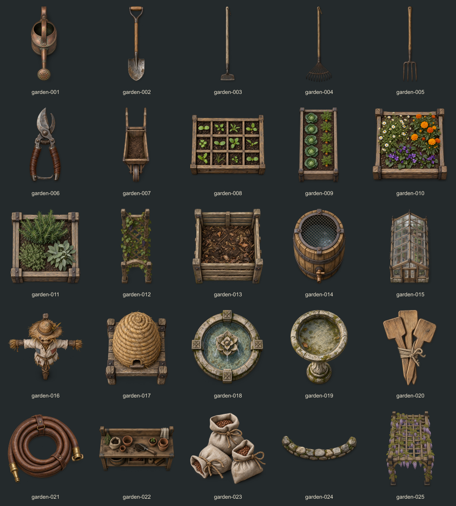
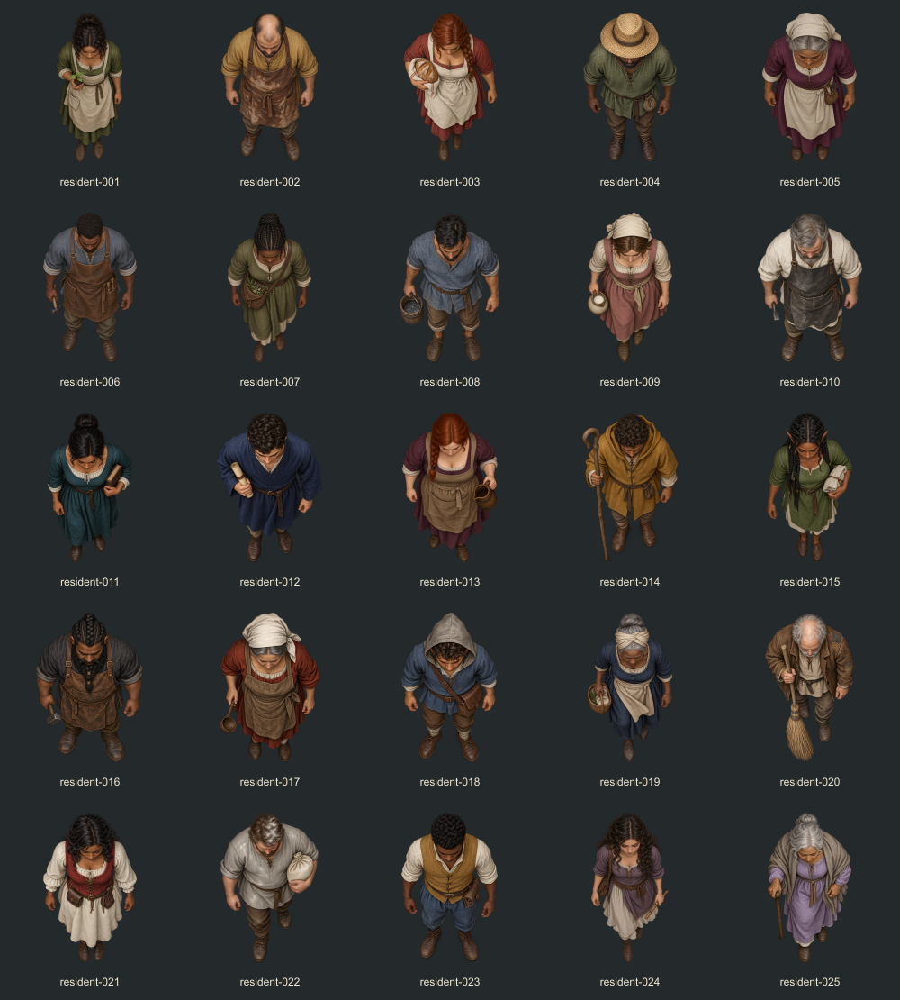
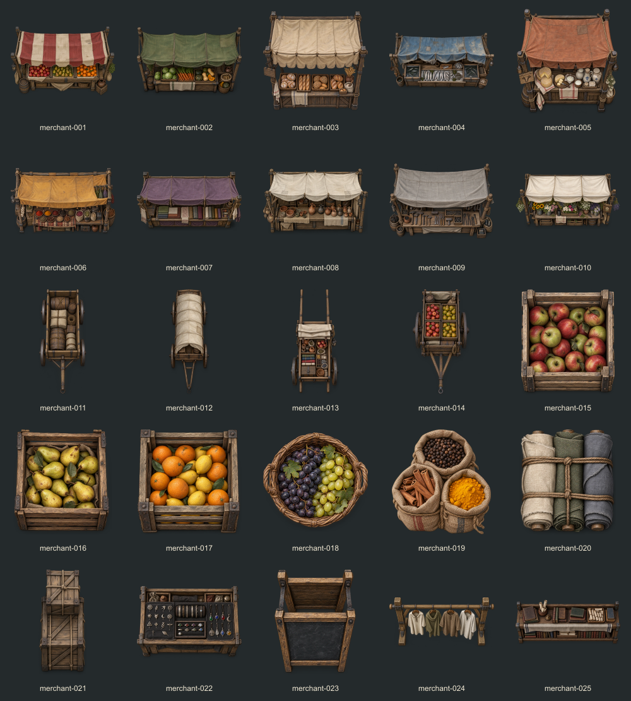

# Acervo de jardinagem, moradores e mercadores

O VTT recebeu 75 artes distintas e transparentes, acessíveis em **Biblioteca → Assets → Jardinagem / Moradores / Mercadores**. Cada coleção tem 25 peças. As coleções também estão disponíveis na aba Cenários.

Jardinagem inclui ferramentas, carrinho de mão, mudas, canteiros, treliça, composteira, barril de chuva, estufa, espantalho, colmeia, fontes e pérgola. Mercadores inclui dez bancas de produtos distintos, carroças, carrinhos, caixas de frutas, sacos de especiarias, fardos, caixas de carga, expositores, cavalete e livros. Os 25 moradores têm nomes, ocupações, aparências e roupas diferentes.

Selecione a arte para ver a prévia e o tamanho em quadrados. Escolha a escala e use Colocar no mapa, ou arraste a peça; o arraste conserva a escala da prévia selecionada. Objetos entram na camada Mapa. Moradores entram na camada Tokens com corpo inteiro e notas de ocupação, usando os atributos editáveis padrão da mesa. Um morador ocupa um quadrado em escala 1×. Anões e halflings têm desenhos proporcionalmente menores, mantendo o quadrado de movimento. Os moradores giram na direção da caminhada e aceitam rotação, nome, controle, PV e condições como os demais tokens.

Moradores parados dentro de casas ficam sob o telhado fechado. A seleção pelo mestre, o controle pelo jogador ou a visão do jogador escolhida revela o interior. Os objetos de jardinagem/comércio colocados no interior acompanham a cobertura; objetos externos continuam visíveis.

As artes foram geradas separadamente pelo **imagegen embutido**, com PNGs nativos preservados em data/vtt/village-life-20261014. Os prompts completos estão em data/vtt/village-life-prompts-20261014.json, e o manifesto registra dimensões, transparência, arquivos e hashes em data/vtt/village-life-manifest-20261014.json. A aplicação usa WebP com margem transparente; a biblioteca carrega miniaturas de até 224 pixels, e a prévia usa a arte completa. Os PNGs originais não são entregues ao navegador.

Validação: 73 testes de comportamento, TypeScript, builds de cliente/servidor, 75 artes únicas com alpha, 75 casos no renderer nativo e testes de biblioteca/arraste/escala/permissões em PostgreSQL UUID descartável. A biblioteca foi conferida em 1440, 768 e 390 pixels. Publicação incremental em Docker, protocolo 18, preservando o acervo anterior e dados da aplicação.

